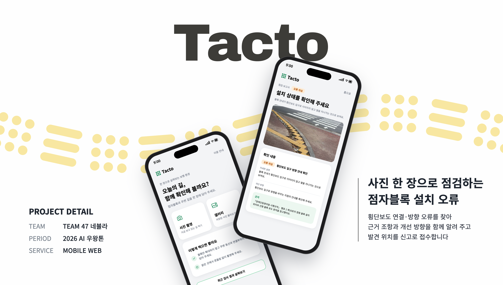
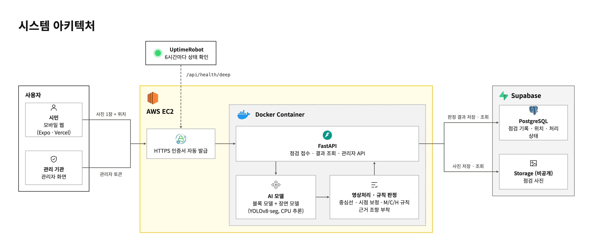
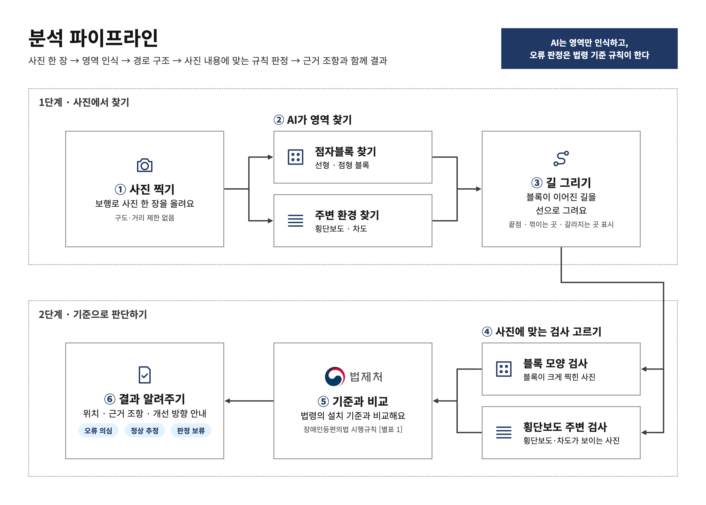

# Tacto — 점자블록 점검 서비스



> 사진 한 장으로 점자블록의 연결과 방향을 살펴보고, 확인이 필요한 위치를 신고하는 모바일 웹 서비스

2026 AI 우왕톤 **TEAM 47 네뷸라**의 프론트엔드 저장소입니다. 사용자가 촬영하거나 선택한 사진을 백엔드에 전달하고, 분석 결과와 확인 기준·개선 방향을 이해하기 쉬운 보고서로 보여줍니다.

**서비스:** [nebula-tacto.vercel.app](https://nebula-tacto.vercel.app)

사진 기반 결과는 현장 점검을 돕는 참고 정보입니다. 정상 추정은 모든 설치 기준의 충족이나 보행 안전을 보장하지 않습니다.

## 서비스 흐름

1. **사진 선택** — 보행로와 점자블록을 촬영하거나 갤러리에서 사진 한 장을 고릅니다.
2. **점검 요청** — 프론트엔드가 사진을 서버로 전송하고 분석 응답을 기다립니다.
3. **보고서 확인** — 오류 의심·정상 추정·판정 보류와 항목별 확인 기준, 관찰 내용, 개선 방향 및 근거를 확인합니다.
4. **신고 접수** — 오류가 의심되면 발견 위치와 내용을 입력해 신고를 접수합니다.
5. **관리자 확인** — 관리자 화면에서 점검·신고 내역과 상세 정보를 살펴보고 처리 상태를 변경합니다.

## 시스템 구성



프론트엔드는 서버에 분석을 요청하고 응답을 화면용 데이터로 변환합니다. 이미지 인식과 규칙 판정은 백엔드가 담당합니다. 관리자 API에는 입력받은 토큰을 사용합니다.

## 분석 흐름



백엔드는 사진에서 점자블록과 주변 환경을 인식하고, 경로 구조와 규칙 판정을 거쳐 결과를 반환합니다. 프론트엔드는 이를 사용자가 읽기 쉬운 점검 보고서로 표시합니다.

## 주요 기능

- **이용 안내:** 첫 실행 안내와 촬영 방법을 제공하고, 완료 여부를 기기에 저장합니다.
- **사진 선택:** 카메라 촬영과 갤러리 선택, 사진 미리보기 및 다시 선택을 지원합니다.
- **점검 진행:** 요청 준비·서버 응답 대기·보고서 정리 단계를 표시하며 요청 취소와 오류를 처리합니다.
- **점검 보고서:** 판정에 해당하는 항목을 보여주고 상세 설명, 개선 방향, 근거를 펼쳐볼 수 있습니다. 반복된 결과의 동일한 설명은 하나로 합칩니다.
- **신고:** 오류 의심 결과에서 위치와 내용을 입력해 신고를 접수합니다.
- **관리자:** 토큰으로 신고 목록과 상세 정보를 조회하고 상태·관리자 메모를 변경합니다.
- **예시 모드:** 실제 서버를 호출하지 않고 화면 흐름을 확인합니다.

## 기술 스택

| 구분 | 기술 |
| --- | --- |
| 앱 및 웹 | Expo SDK 58, React Native, React Native Web |
| 언어 | TypeScript |
| 화면 이동 | Expo Router |
| 사진 | Expo Image Picker, Image Manipulator |
| 배포 | Vercel 정적 웹 배포 |
| 백엔드 연동 | FastAPI HTTP API |

## 프로젝트 구조

```text
app/                    Expo Router 화면과 레이아웃
  index.tsx             첫 실행 분기
  onboarding.tsx        이용 안내
  home.tsx              촬영·갤러리 선택
  inspection.tsx        사진 확인과 점검 시작
  loading.tsx           요청 진행·취소
  result.tsx            판정과 상세 보고서
  report.tsx            위치 입력과 신고 접수
  admin.tsx             관리자 화면
components/             공통 UI와 일러스트
services/               API, 응답 변환, 상태, 사진 선택, 저장소
constants/              테마와 예시 결과
types/                  화면 데이터 타입
assets/                 앱 아이콘과 이미지
tests/                  데이터 변환과 API 등 자동 검사
```

## 로컬 실행

Node.js 22 LTS 이상을 준비하고 프로젝트 루트에서 실행합니다.

```powershell
npm ci
Copy-Item .env.example .env
npm run web
```

이미 `.env`가 있다면 덮어쓰지 말고 필요한 값만 확인하세요. 다른 실행 방법:

```powershell
npm start
npm run android
npm run ios
```

Android·iOS 실행에는 해당 플랫폼 환경이나 호환되는 Expo Go 또는 개발 빌드가 필요합니다.

## 환경변수 및 서버 연결

```dotenv
EXPO_PUBLIC_API_URL=http://192.168.0.10:8000
```

백엔드의 기본 주소를 `/api` 없이 입력합니다. 실제 휴대폰에서는 `localhost` 대신 접근 가능한 서버 주소를 사용하세요. 환경변수를 바꾼 뒤 개발 서버를 다시 시작합니다. 운영 웹에서는 HTTPS 백엔드 주소와 해당 웹 도메인에 대한 CORS 설정이 필요합니다.

`EXPO_PUBLIC_` 값은 클라이언트에 공개되므로 비밀키를 넣지 마세요. 관리자 토큰은 화면에서 입력하며 웹에서는 탭 단위 세션 저장소를 사용합니다.

## API 연동

| 기능 | 요청 |
| --- | --- |
| 사진 점검 | `POST /api/inspections` — multipart `photo` |
| 신고 접수 | `POST /api/inspections/{id}/report` — 위치와 내용 |
| 관리자 목록 | `GET /api/admin/inspections?limit=100` |
| 관리자 상세·상태 변경 | `GET /api/admin/inspections/{id}`, `PATCH /api/admin/inspections/{id}` |

점검 응답은 `services/inspection-schema.ts`에서 화면에 맞게 변환합니다. 화면의 규칙 설명과 일부 개선 방향은 프론트엔드에서 사용자 친화적인 문구로 정리합니다. 점검 요청은 최대 60초를 기다리며, 요청 취소가 이미 시작된 서버 분석까지 중단하는 것은 아닙니다.

## 배포

이 프로젝트에는 `vercel.json`이 포함되어 있습니다. Vercel 빌드는 `npx expo export -p web`을 실행하고 `dist`를 배포합니다. Vercel 프로젝트의 Production 환경변수에 `EXPO_PUBLIC_API_URL`을 설정하세요.

```powershell
npx vercel --prod
```

CLI 배포는 현재 로컬 프로젝트를 배포합니다. GitHub 자동 배포를 사용하려면 Vercel 프로젝트와 저장소를 별도로 연결해야 합니다.

## 확인 명령어

```powershell
npm run lint
npm run typecheck
npm test
```

사진 권한과 선택 취소, 실제 서버 연결, 신고 접수, 관리자 화면은 대상 기기와 브라우저에서도 확인하세요.
